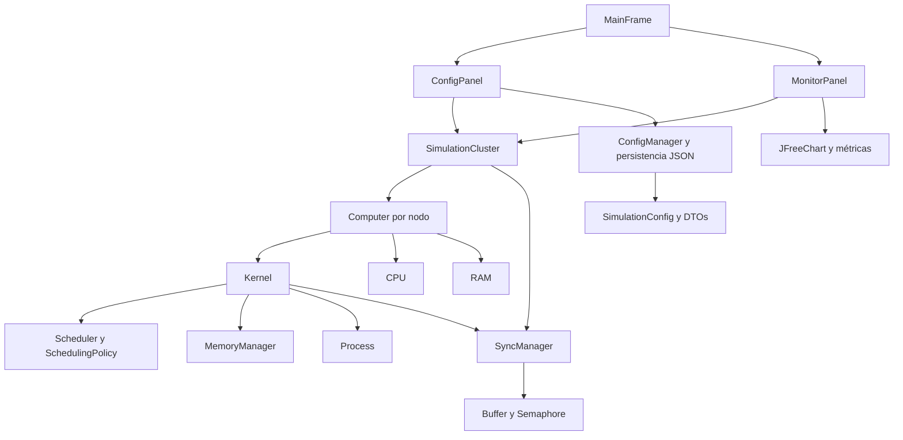

# Arquitectura de ÁvilaOS

ÁvilaOS es una aplicación Java de escritorio que simula varios computadores y
sus sistemas operativos. Todos los nodos y recursos compartidos viven dentro de
una instancia de `SimulationCluster`; no se conectan máquinas ni se envían
paquetes reales.

## Componentes y flujo



### Aplicación y simulación

- `avilaos.Main` inicializa Swing y muestra `MainFrame`.
- `MainFrame` construye la configuración, el monitor y las acciones de guardar,
  cargar y exportar.
- `SimulationCluster` mantiene la colección de computadores, el ciclo global,
  la latencia de red y los buffers compartidos. `advanceCycle()` incrementa el
  ciclo una vez y ejecuta todos los computadores en orden.
- Cada `Computer` agrupa su `CPU`, `RAM` y `Kernel`; los computadores del clúster
  comparten un `SyncManager`.

### Kernel y recursos

- `Kernel` ejecuta los ciclos locales, atiende plazos, planifica procesos y
  administra las colas NEW, READY, BLOCKED y TERMINATED.
- `Scheduler` aplica una `SchedulingPolicy`: FCFS, EDF, Round Robin o prioridad
  preventiva.
- `MemoryManager` admite procesos si hay memoria y libera la reserva cuando el
  proceso termina. Los requisitos de configuración se expresan en MB; `RAM`
  contabiliza bytes y realiza la conversión con comprobación de desbordamiento.
- `SyncManager` administra buffers globales. Cada `Buffer` usa semáforos para
  capacidad, disponibilidad y exclusión mutua. La latencia remota se simula
  contando ciclos.
- Las estructuras de datos del proyecto bajo `avilaos.util.datastructures`
  proporcionan colas y listas usadas por el kernel y la simulación.

### Interfaz, ciclos y métricas

- `ConfigPanel` edita la configuración global, computadores, procesos y
  buffers.
- `MonitorPanel` presenta el ciclo, CPU, RAM, colas, buffers, eventos y gráficos
  de utilización de CPU y procesos por estado. También permite exportar la
  vista a PNG, CSV y HTML.
- **Avanzar ciclo** ejecuta un paso manual. **Iniciar** y **Pausar** controlan un
  `javax.swing.Timer` de Swing que invoca `SimulationCluster.advanceCycle()` en
  el hilo de eventos de la interfaz, usando la duración configurada. Al cargar
  una configuración se detiene el timer anterior; al cerrar la ventana se
  detienen el timer y los computadores.
- `MetricsCollector` y los objetos de snapshot recopilan métricas para su
  presentación y exportación. Los gráficos reflejan valores actuales y métricas
  acumuladas; no son series históricas por ciclo.

## Persistencia y datos

`ConfigManager` coordina la validación y la persistencia JSON a partir de
`SimulationConfig`, `ComputerConfig`, `ProcessConfig` y las configuraciones de
buffers. Guardar o cargar conserva la **configuración** para crear una
simulación nueva; no serializa el estado de ejecución, las colas, el ciclo
actual ni un checkpoint.

## Paquetes fuente

| Paquete | Responsabilidad |
|---|---|
| `avilaos.config` | Coordinación de lectura y escritura de configuración. |
| `avilaos.core` | Reloj, computador y componentes simulados. |
| `avilaos.gui` | Ventana, configuración y monitor Swing. |
| `avilaos.kernel` | Ciclo del sistema operativo y gestión de procesos. |
| `avilaos.metrics` | Recopilación y snapshots de métricas. |
| `avilaos.model` | DTOs, enumeraciones e información del proceso (PCB). |
| `avilaos.persistence` | Serialización JSON y validación. |
| `avilaos.simulation` | Coordinación de computadores y recursos distribuidos. |
| `avilaos.util.datastructures` | Estructuras de datos propias. |

Las pruebas automatizadas están bajo `avilaos/src/test/java`. Maven está
configurado en el `pom.xml` raíz, compila con Java 21 y ejecuta las pruebas con
JUnit 5.

## Validación local y CI

Con JDK 21 y Maven 3.9 o superior:

```powershell
mvn -B clean verify
```

El workflow de GitHub Actions ejecuta el mismo comando en cada push y pull
request, usando Temurin JDK 21 y caché de dependencias Maven.
